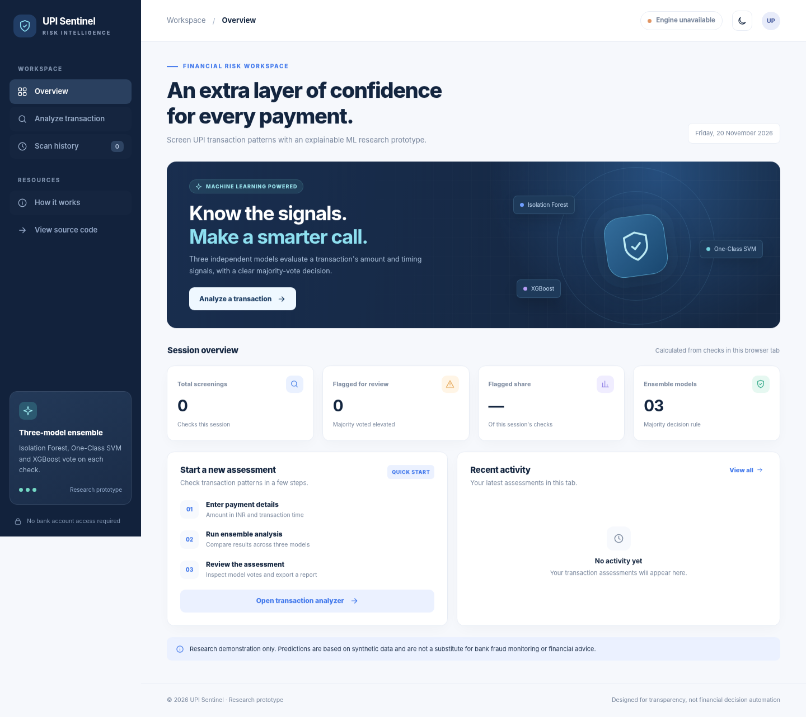
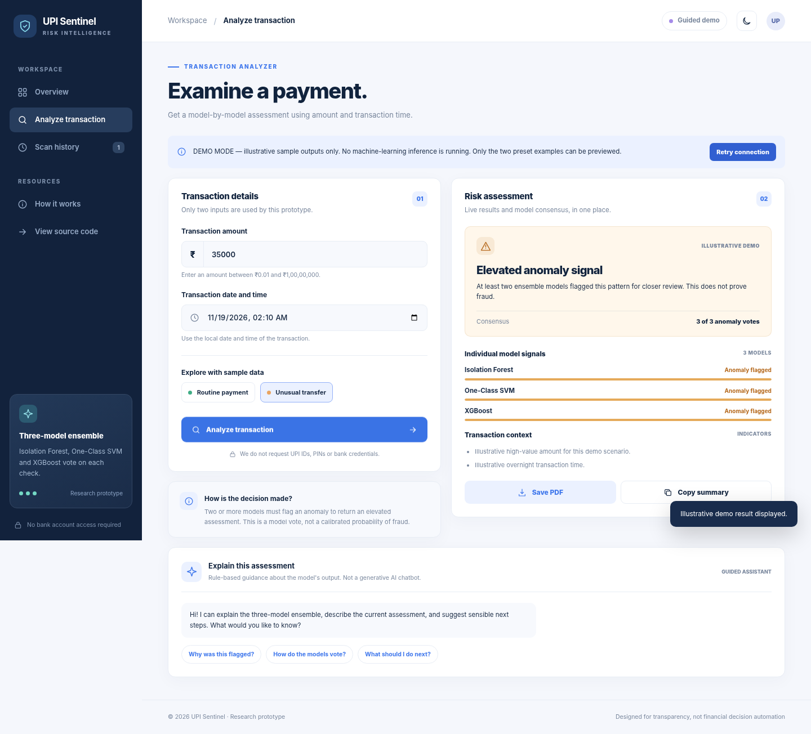
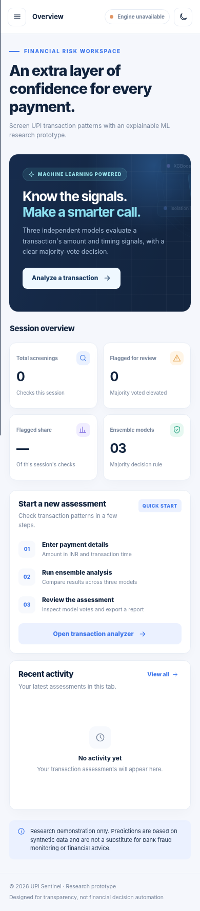

# UPI Sentinel · Fraud Detection Research Dashboard

> A full-stack, portfolio-ready **research prototype** for interpreting UPI transaction anomalies with three machine-learning models. **Synthetic training data only; not validated for detecting actual fraud.**



## Highlights

- Responsive transaction-intelligence workspace with separate Overview, Analyzer, Session History and Methodology views.
- Light/dark modes, guided explanations, sample scenarios, session-only history, CSV export, and browser **Print / Save as PDF** reports.
- Three-model ensemble: **Isolation Forest**, **One-Class SVM**, and **XGBoost**, with strict 2-of-3 voting.
- Reproducible *synthetic* data generator, log-amount / cyclical-time features and standardized model inputs.
- Validation of amounts, dates, payload types and sizes; consistent JSON errors, scoped frontend file serving, restrictive CORS and security headers.
- Flask REST API, training CLI, Render deployment Blueprint and pytest/GitHub Actions coverage.
- Unambiguous **guided demo mode** when the ML API is unavailable. Its example outputs are illustrations, **never represented as live inference**.

| Analyzer (illustrative demo) | Mobile dashboard |
| --- | --- |
|  |  |

## Technology

| Layer | Stack |
| --- | --- |
| UI | Semantic HTML5, vanilla JavaScript, CSS variables, SVG icon system |
| Server | Python, Flask, Gunicorn |
| ML | scikit-learn, XGBoost, NumPy, Pandas, joblib |
| Automation | pytest, GitHub Actions |
| Hosting | Render (complete app), optional Vercel (static frontend only) |

## Quick start (macOS, Linux, Windows)

Use **Python 3.11 or 3.12**. At repository root:

```bash
python3 -m venv .venv
source .venv/bin/activate          # Windows PowerShell: .venv\Scripts\Activate.ps1
python -m pip install -r requirements.txt
python train.py                     # trains/saves the synthetic model locally
python app.py                       # Flask development server
```

Open **http://127.0.0.1:5001**. The badge should read **ML engine online**.

To run the full test suite:

```bash
python -m pip install -r requirements-dev.txt
python -m pytest -q
node --check public/script.js       # optional, requires Node.js
```

`python train.py` writes `.model_cache/ensemble.joblib`, excluded from version control. **Do not unpickle model artifacts downloaded from untrusted sources.** To retrain, remove the cached file and run `python train.py` again.

## API

### GET `/api/health`

Returns `200` and `{"status":"ready", "training_data":"synthetic_only", ...}` if the model is available. Returns `503` and `status: not_ready` if it has not been trained yet.

### POST `/api/check_fraud`

```bash
curl -X POST http://127.0.0.1:5001/api/check_fraud \
  -H 'Content-Type: application/json' \
  -d '{"amount":35000,"timestamp":"2026-11-18 02:10"}'
```

Example response (actual votes depend on the trained artifact and parameters):

```json
{
  "isolation_forest": "Potential Fraud",
  "svm": "Potential Fraud",
  "xgboost": "Potential Fraud",
  "fraud_detected": true,
  "fraud_votes": 3,
  "risk_level": "elevated",
  "training_data": "synthetic_only",
  "signals": ["Descriptive context 1", "Descriptive context 2"],
  "disclaimer": "Research prototype only. Not validated for real UPI fraud decisions."
}
```

Amounts must be numeric or valid INR-formatted strings between ₹0.01 and ₹1,00,00,000; timestamps must be parseable ISO date/time strings in years 2020–2100. Malformed requests return a descriptive 400/415 response.

## Machine learning: what the project actually measures

The data generator creates approximately 92% *routine synthetic* records and 8% *anomalous synthetic* records, with overlapping amount and time-of-day distributions. Labels are computer-generated. The engineering pipeline:

1. Transform amount with `log1p`, time of day into sine and cosine, then standardize on routine-only training observations.
2. Train Isolation Forest and One-Class SVM on routine synthetic examples only.
3. Train XGBoost on the labelled synthetic training split.
4. Apply the three models on the held-out split; use two or more votes for an elevated signal.
5. Report the model-vote output, not a fabricated fraud probability.

A deterministic run on **4,200 synthetic examples** (840 held out) on the updated code produced **precision 0.743, recall 0.821 and F1 0.780** for majority-vote detection of *synthetic anomalies*. This does **not** measure real-world UPI fraud performance. It would require genuine, consented, labeled transaction data, stronger features, representative evaluation, fairness/security audits, and robust calibration.

## Deployment

**Recommended: deploy both frontend and ML API on Render.** `render.yaml` is included. See [DEPLOYMENT.md](DEPLOYMENT.md) for the complete GitHub upload, Render and optional Vercel instructions.

**If using Vercel:** set its **Root Directory to `public`**, use the **Other** framework preset with no build command, and deploy the Python backend separately on Render. Then edit `public/config.js` to point to the Render URL and set `CORS_ORIGINS` on Render to your *exact* Vercel origin. If you deploy only the static files with the default config, the page will display **Engine unavailable** and offer a clearly labeled guided demo; custom ML predictions will not run.

## Repo layout

```text
.
├── public/
│   ├── index.html           # responsive UI, all four workspace views
│   ├── style.css            # design system + light/dark themes
│   ├── script.js            # browser interactions and API requests
│   ├── config.js            # optional hosted API base URL
│   └── favicon.svg
├── app.py                   # Flask routes, validation, headers, CORS
├── model.py                 # feature prep, training, inference, voting
├── generate_transactions.py # reproducible synthetic data generator
├── train.py                 # builds locally trusted joblib artifact
├── tests/                   # model and Flask route/API tests
├── .github/workflows/ci.yml # CI
├── render.yaml / Procfile   # deployment config
├── requirements.txt
└── DEPLOYMENT.md
```

## Important limitations

This app **does not access UPI, banking services, or real transaction data**. It does not determine recipient legitimacy, detect phishing, or block/reverse payments. Session history is stored in the tab's `sessionStorage`, so it is not an audit database. Guided demo results are fixed illustrations, not live ML results. The “explain this assessment” prompts are deterministic guidance, not a generative AI service. Do not enter banking credentials, OTPs, UPI PINs, or sensitive account identifiers.

For a production financial platform, add authentication, authorization, API quotas/rate limiting, structured monitoring, a secure database, audited fraud labels, a model registry, drift detection and privacy controls. The current starter is not appropriate for autonomous payment blocking.

## Resume-ready project description

**UPI Sentinel — ML-Powered Transaction Anomaly Dashboard** | Python, Flask, scikit-learn, XGBoost, HTML/CSS/JavaScript

- **Built** an end-to-end UPI transaction anomaly-screening research application with a responsive dashboard, a REST API and three-model ensemble; **implemented 2-of-3 consensus voting and model-by-model explanations**.
- **Achieved 0.780 F1 on a reproducible 840-record held-out synthetic test set** by engineering cyclical time features, scaling model inputs and combining Isolation Forest, One-Class SVM and XGBoost; **metrics are synthetic-only**.
- **Added** session history, report exports, validation, isolated training artifacts, CI tests and deployment configuration to improve demonstration readiness and maintainability.

## License

No license file is provided. Add your chosen open-source license if you intend others to reuse the code.
